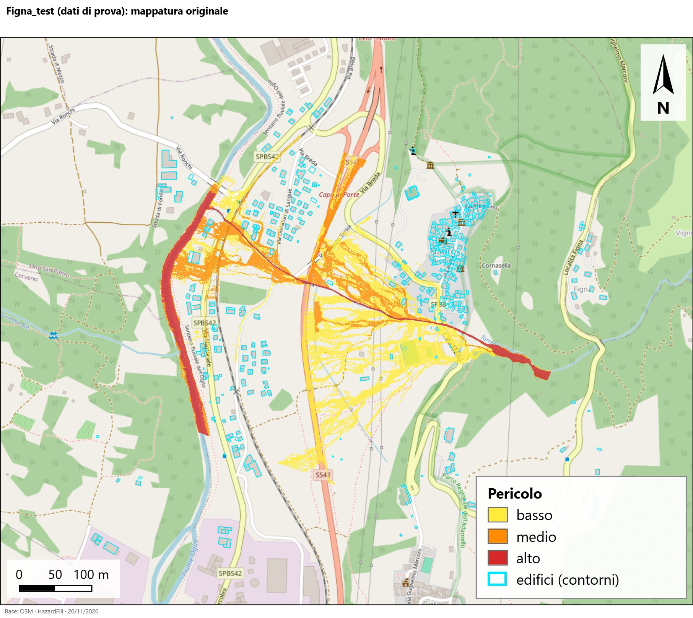
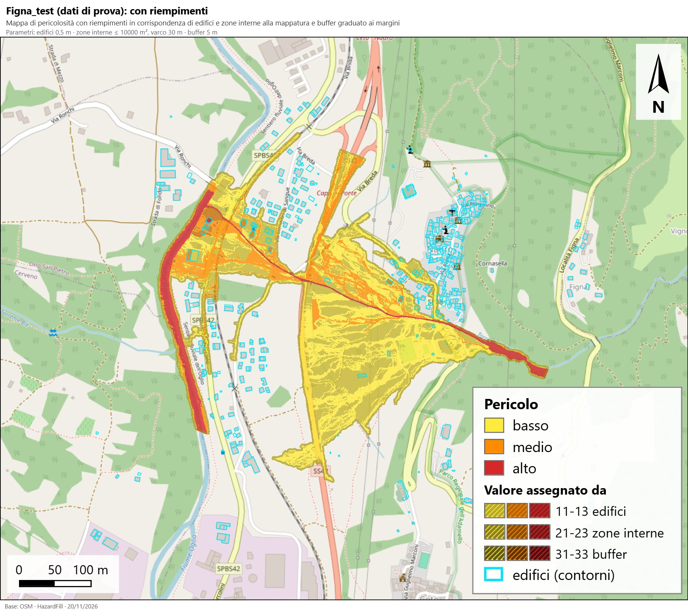
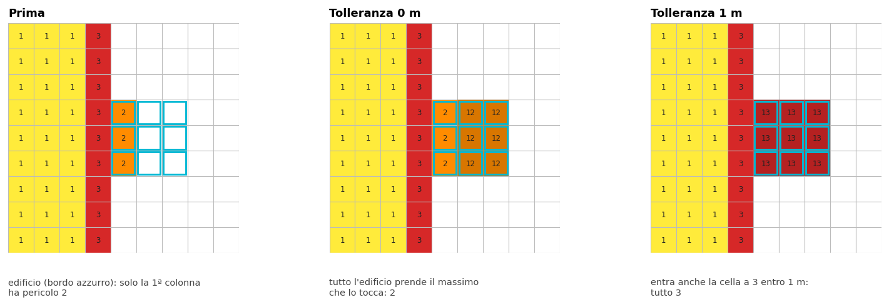
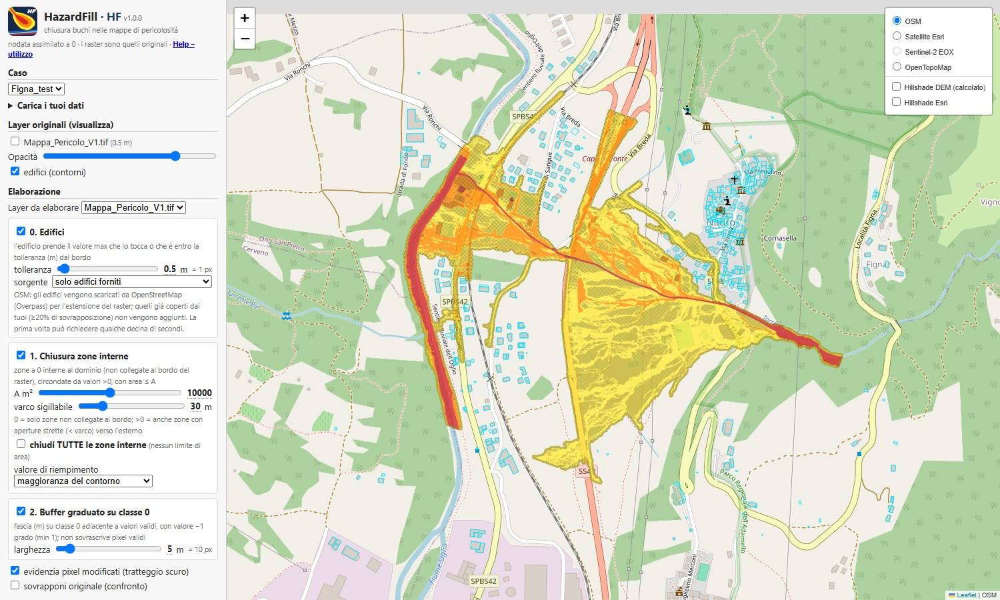
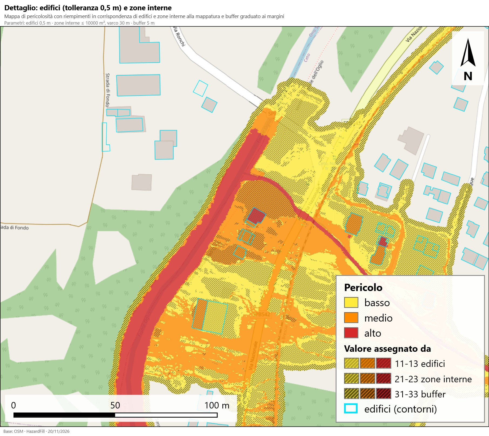

<p align="center"></p>

# HazardFill (HF)

**Pre-screening delle mappe di pericolosità: chiusura delle aree prive di valore** — plugin QGIS e pagina web.

[](LICENSE)
[](docs/plugin-qgis.md)
[](https://github.com/HydrogeomorphologyTools/HazardFill/actions)

> ### Avvertenza
> HazardFill è un **ausilio di pre-screening** per i **gestori del territorio** nella **fase di valutazione finale della mappatura del pericolo**,
> per una **scelta e una gestione più consapevoli del vincolo** da apporre sul territorio.
> **Non produce mappe di pericolosità**, non sostituisce la modellazione né la valutazione di esperti, e i valori proposti sono
> *esempi di partenza*, non soglie di validità generale. Ogni modifica è tracciata (codici nei raster e nei vettoriali) perché il decisore
> possa sempre distinguere il dato simulato da quello assegnato.
> I dati in [`examples/`](examples/) sono **dati di prova**: non sono mappature di pericolosità reali né ufficiali.

**In English.** HazardFill (HF) is a pre-screening aid for land managers, used in the final stage of hazard-map assessment, to support a more informed
decision on the land-use constraint. Given a class-based hazard raster (0 = none/nodata, 1 low, 2 medium, 3 high) it (i) assigns to each building the
maximum class touching it (or within a tolerance), (ii) fills unrealistic "no-hazard" holes inside the modelled domain, and (iii) adds a graded buffer
(one class lower) beyond the modelled margin. Every modified pixel is tagged with a code (`class + 10 × criterion`). It ships as a QGIS plugin and as a
local web page, sharing the same numpy/scipy core. Documentation is in Italian. It is *not* a hazard-mapping or modelling tool.

<p align="center">


<br><em>Dati di prova (Figna_test): mappatura originale (a sinistra) e con riempimenti (a destra). I pixel modificati sono tratteggiati e riportano il loro codice.</em>
</p>

## A cosa serve

Le mappe di pericolosità ottenute dalla modellazione presentano spesso discontinuità poco realistiche: **edifici privi di valore** (nella simulazione sono ostacoli o sono rimossi),
**isole di «nessun pericolo»** racchiuse nell'area mappata e **margini** in cui il valore si interrompe bruscamente. Prima di fissare un vincolo è utile vedere
*cosa cambierebbe* applicando criteri espliciti e riproducibili: HazardFill lo mostra, parametro per parametro, confrontando la mappatura originale con quella con i riempimenti.

## I tre criteri (applicati in quest'ordine)

| # | Criterio | In breve | Parametri (valori di partenza) |
|---|---|---|---|
| 0 | **Edifici** | ogni edificio prende il valore **massimo** che lo tocca o che è entro una tolleranza dal bordo; non abbassa mai valori esistenti | tolleranza **0 m**; sorgente edifici (forniti / forniti + OpenStreetMap / solo OSM) |
| 1 | **Zone interne** | le zone a 0 interne al dominio (non collegate al margine del raster) si riempiono se l'area è ≤ soglia, oppure tutte; un **varco sigillabile** include anche le zone con aperture strette | area **10 m²**, varco **0 m**, riempimento **maggioranza** del contorno (o massimo / più vicino) |
| 2 | **Buffer sul margine** | fascia sulla classe 0 adiacente ai pixel validi con valore del più vicino **−1 grado** (minimo 1), senza sovrascrivere pixel validi | larghezza **1 m** |

<p align="center"></p>

Tutti gli esempi sintetici (zone interne, varco, valore di riempimento, buffer) sono in [`docs/metodo.md`](docs/metodo.md) e nell'**Help – utilizzo** dello strumento.

## Funzionalità

* **Plugin QGIS** (algoritmi di Processing, quindi anche in batch e nei modelli grafici) e **pagina web locale** con la stessa logica e gli stessi risultati.
* **Edifici**: da shapefile, GeoPackage o GeoJSON (qualsiasi CRS), oppure **ricavati/integrati da OpenStreetMap** (un edificio OSM è aggiunto solo se meno del 20% della sua superficie cade su edifici già presenti).
* **Tracciabilità**: ogni pixel modificato ha un **codice** (`classe + 10 × criterio`: 11-13 edifici, 21-23 zone interne, 31-33 buffer).
* **Esporta mappatura**: raster con codici, raster pulito (0-3) con stile QGIS `.qml`, **GeoPackage vettoriale** a 4 livelli (`originale`, `omogeneizzata`, `mappa_con_codici`, `modifiche`) con stile incorporato.
* **Esporta mappa (PNG)**: titolo, legenda dei soli criteri applicati, freccia del nord, scala, 150 dpi; scelta *come a schermo / originale / con riempimenti*.
* **Pagina web**: carta con basi (OSM, satellite, Sentinel-2, topografica), **hillshade** calcolato dal DEM, sovrapposizione dei layer, confronto con l'originale, statistiche (m² per classe, pixel modificati per criterio), **caricamento di GeoTIFF ed edifici dal computer** o lavoro su una cartella di dati.
* Tutti i valori in **metri e metri quadrati**: la risoluzione del raster è usata per convertirli in pixel.
* **Help – utilizzo** con esempi sintetici calcolati con il codice vero.

<p align="center"></p>

## Installazione

### Plugin QGIS (≥ 3.22)
1. Scarica `HazardFill_plugin_<versione>.zip` dalle [release](https://github.com/HydrogeomorphologyTools/HazardFill/releases).
2. QGIS → *Plugin → Gestisci e installa plugin → Installa da ZIP*.
3. Menu **Raster → HazardFill**: elabora, esporta mappa, basi cartografiche, Help – utilizzo. Gli algoritmi sono anche nel pannello Processing, gruppo «Mappe di pericolosità».

Dettagli: [`docs/plugin-qgis.md`](docs/plugin-qgis.md).

### Pagina web (locale)
Serve Python 3.10 o successivo.

```bash
git clone https://github.com/HydrogeomorphologyTools/HazardFill.git
cd HazardFill/web
pip install -r requirements.txt
python server.py            # apre sull'esempio Figna_test: http://localhost:8765
python server.py --data /percorso/alle/tue/aree      # una sottocartella per area
```

Oppure scarica `HazardFill_web_<versione>.zip` dalle release (contiene già l'esempio) e avvia `avvia_hazardfill_web.bat` (Windows) o `avvia_hazardfill_web.sh`.
Nella pagina, la sezione **«Carica i tuoi dati»** permette di caricare un GeoTIFF e gli edifici dal computer.

Dettagli: [`docs/web-locale.md`](docs/web-locale.md).

## Dati in ingresso

* **Raster di pericolosità**: una banda, griglia con nord in alto, **CRS proiettato in metri**, solo le classi **0** (nessun pericolo / nodata), **1** basso, **2** medio, **3** alto. Il NoData e i valori negativi sono assimilati a 0.
* **Edifici** (facoltativi): poligoni; shapefile (anche .zip nel caricamento web), GeoPackage o GeoJSON, qualsiasi CRS.

Formati, codici di uscita e metadati: [`docs/formati-e-codici.md`](docs/formati-e-codici.md).

## Esempio

La cartella [`examples/Figna_test`](examples/Figna_test) contiene un raster e gli edifici di prova. Il passo-passo, con immagini, è in [`docs/esempio-figna-test.md`](docs/esempio-figna-test.md).

<p align="center"></p>

## Limiti da conoscere

* Il calcolo è **raster** e lavora **in memoria** su tutto il raster (a 0,5 m i raster da milioni di pixel richiedono secondi o minuti e alcuni GB di RAM).
* Il **NoData è assimilato a 0**: lo strumento non distingue le aree escluse dal calcolo da quelle non raggiunte dal processo; i risultati vanno verificati con questa cautela.
* Le zone «interne» sono quelle a 0 non collegate al bordo del raster: serve verificare visivamente che non corrispondano a condizioni fisiche reali (rilievi non raggiunti dal flusso, bracci d'acqua).
* Il buffer estende la perimetrazione oltre il risultato modellistico: è una **convenzione cartografica**, non una relazione fisica fra distanza e pericolo.
* Gli edifici OpenStreetMap hanno copertura variabile; dei multipoligoni si usano solo gli anelli esterni. Serve connessione internet per scaricarli.
* I poligoni del vettoriale seguono i bordi dei pixel (profilo a gradini).

## Documentazione

[`docs/`](docs/README.md): [metodo](docs/metodo.md) · [plugin QGIS](docs/plugin-qgis.md) · [pagina web locale](docs/web-locale.md) · [formati e codici](docs/formati-e-codici.md) · [esempio Figna_test](docs/esempio-figna-test.md) · [sviluppo e test](docs/sviluppo.md).

## Come citare

Vedi [`CITATION.cff`](CITATION.cff) (GitHub mostra il pulsante «Cite this repository»).

> Crema S., Cavalli M., Sarretta A. (2026). *HazardFill (HF): pre-screening delle mappe di pericolosità (chiusura delle aree prive di valore)*. CNR-GEO (Istituto di Geoscienze). https://github.com/HydrogeomorphologyTools/HazardFill

## Autori e licenza

**Stefano Crema, Marco Cavalli, Alessandro Sarretta** — CNR-GEO (Istituto di Geoscienze).

Software libero, distribuito con licenza **GNU General Public License versione 2** ([`LICENSE`](LICENSE)), **senza alcuna garanzia**.
Dati OpenStreetMap © contributori OpenStreetMap (ODbL). Le basi cartografiche della pagina web appartengono ai rispettivi fornitori e ne rispettano le condizioni d'uso (OSM, Esri, EOX Sentinel-2 cloudless © EOX CC BY-NC-SA, OpenTopoMap CC-BY-SA, DEM Terrarium su AWS Open Data).

## Segnalazioni e contributi

Segnalazioni e proposte tramite [Issues](https://github.com/HydrogeomorphologyTools/HazardFill/issues). Per sviluppare e provare le modifiche vedi [`docs/sviluppo.md`](docs/sviluppo.md).
