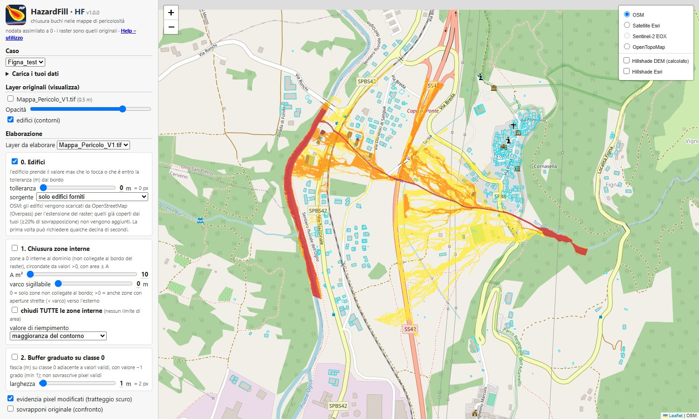
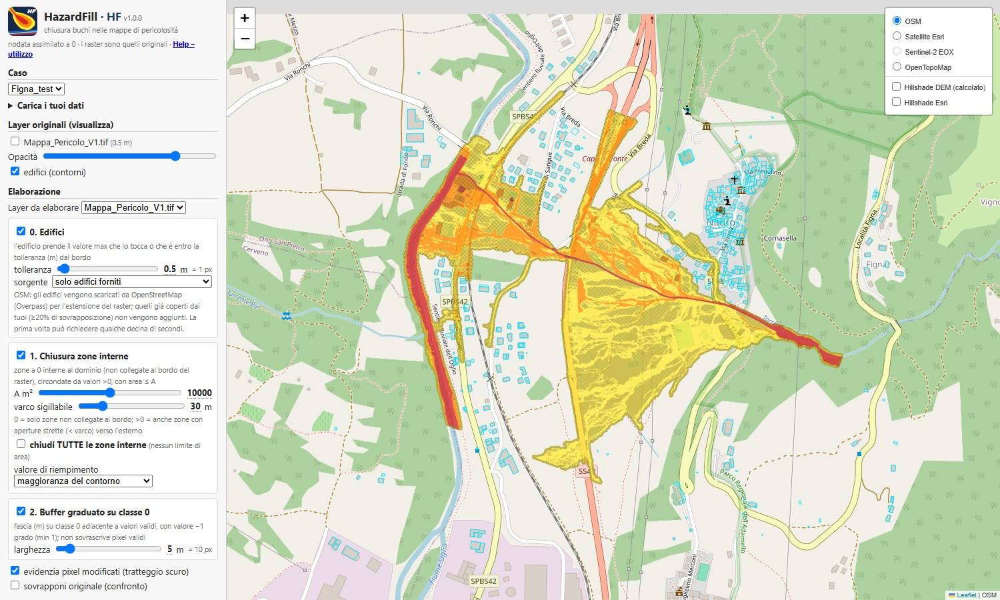
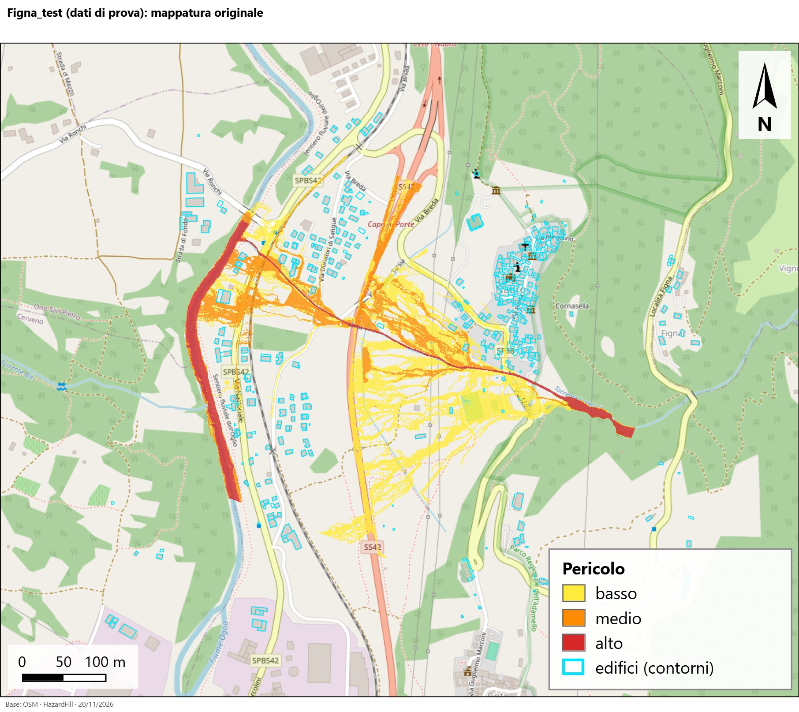
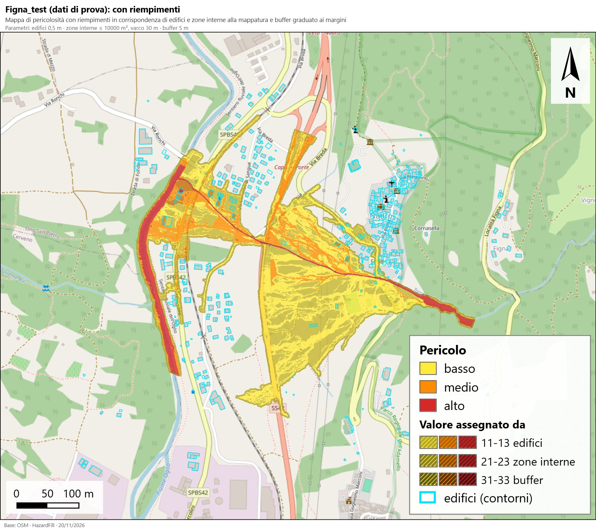
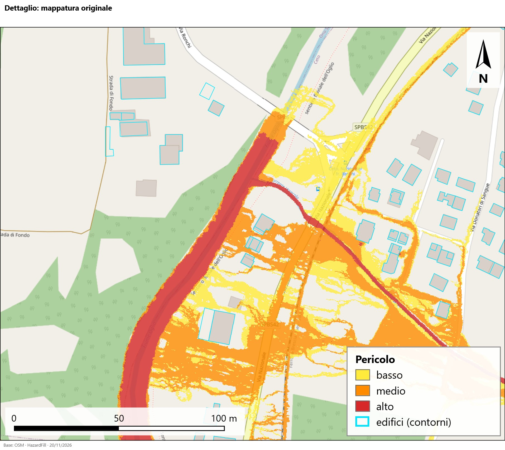
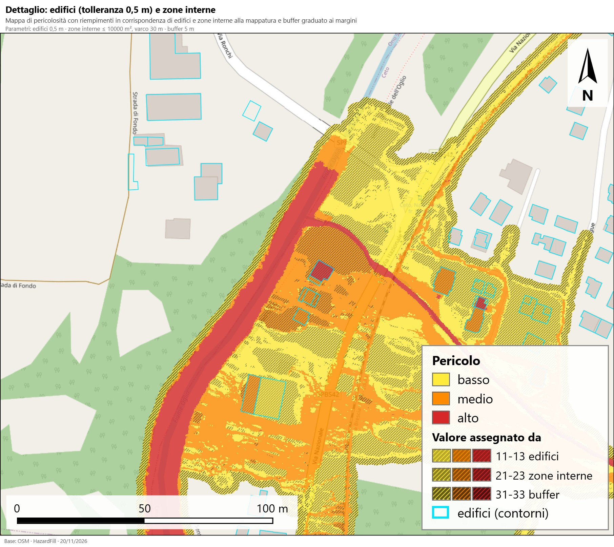
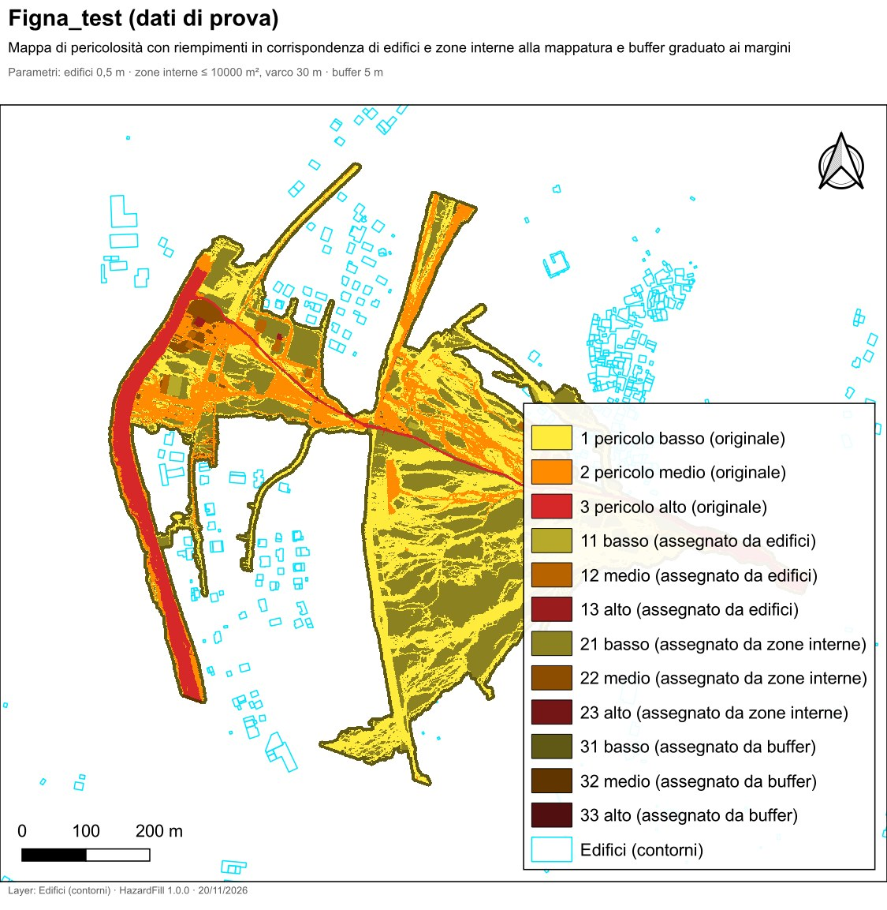

# Esempio passo-passo: Figna_test

> **I dati di [`examples/Figna_test`](../examples/Figna_test) sono dati di prova**: non rappresentano mappature di pericolosità reali né ufficiali e servono solo a mostrare come funziona lo strumento.

La cartella contiene un raster (`Mappa_Pericolo_V1.tif`, 0,5 m, EPSG:32632, classi 0-3) e gli edifici (`Edifici/Edifici.shp`).

## Con la pagina web

1. Avvia il server (`cd web && python server.py`) e apri http://localhost:8765: compare l'area **Figna_test**.

   

2. Lascia attivi i **valori di partenza** (edifici 0 m, riempimento per maggioranza) e attiva **Chiusura zone interne** e **Buffer graduato**.
   Per ripetere l'esempio qui sotto imposta: edifici **0,5 m**, zone interne **10 000 m²**, varco **30 m**, buffer **5 m**
   (oppure apri direttamente `http://localhost:8765/?bld=1&bm=0.5&holes=1&area=10000&gap=30&buf=1&bufm=5&hmode=major`).

   

3. Leggi le **statistiche**: con questi parametri i pixel modificati sono **13 445** dagli edifici (≈ 3 361 m²), **346 030** dalle zone interne (≈ 86 508 m²) e **181 329** dal buffer (≈ 45 332 m²).
4. Confronta con l'originale (*sovrapponi originale*) e verifica sulla topografia che le modifiche abbiano senso.
5. **Esporta**:
   * *Esporta mappa (immagine)* → PNG con legenda, nord e scala (qui sotto, a sinistra l'originale e a destra con i riempimenti);
   * *Esporta mappatura* → raster con codici, raster pulito, stile QGIS, GeoPackage.

### Dettaglio

Sulle case della zona a sinistra si vede il criterio **edifici** (gli edifici assumono il valore dei pixel che li toccano), il **buffer** tratteggiato ai margini e le **zone interne** chiuse.
Il tratteggio è più scuro per i criteri successivi, come in legenda (11-13, 21-23, 31-33).

## Con il plugin QGIS

1. Aggiungi a QGIS `Mappa_Pericolo_V1.tif` e `Edifici/Edifici.shp`.
2. *Raster → HazardFill → Elabora mappa di pericolosità…* e imposta gli stessi parametri (tolleranza 0,5 m, area 10 000 m², varco 30 m, riempimento «maggioranza», buffer 5 m).
   Indica i file di uscita: raster con codici, e se vuoi raster pulito e vettoriale GeoPackage.
3. I risultati si aprono già con lo stile; il GeoPackage aggiunge i suoi livelli al progetto.
4. *Raster → HazardFill → Aggiungi basi cartografiche…* e poi *Esporta mappa con legenda, nord e scala (PNG)…* per ottenere l'immagine.

*(Nell'immagine del plugin non c'è la base cartografica, perché nel test non erano caricate basi.)*

## Cosa osservare

* I pixel con codice **≥ 11** sono quelli assegnati dallo strumento: sono il punto da discutere e da verificare.
* Se una zona chiusa corrisponde a un rilievo non raggiunto dal flusso, riduci l'area massima, lascia il varco a 0 o disattiva il criterio.
* Per un'impostazione prudente scegli il riempimento **massimo del contorno**.
