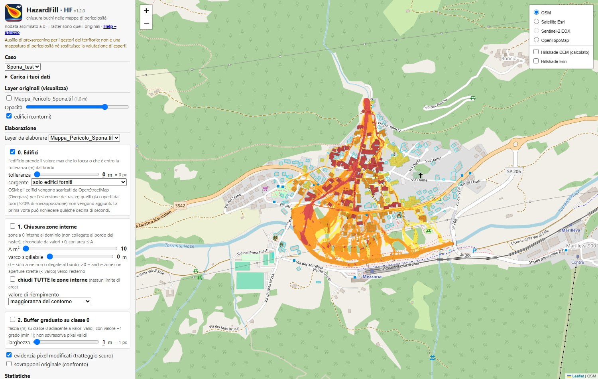
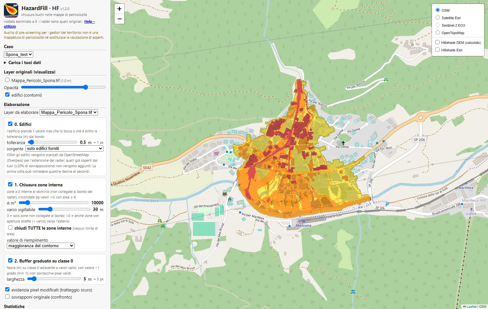
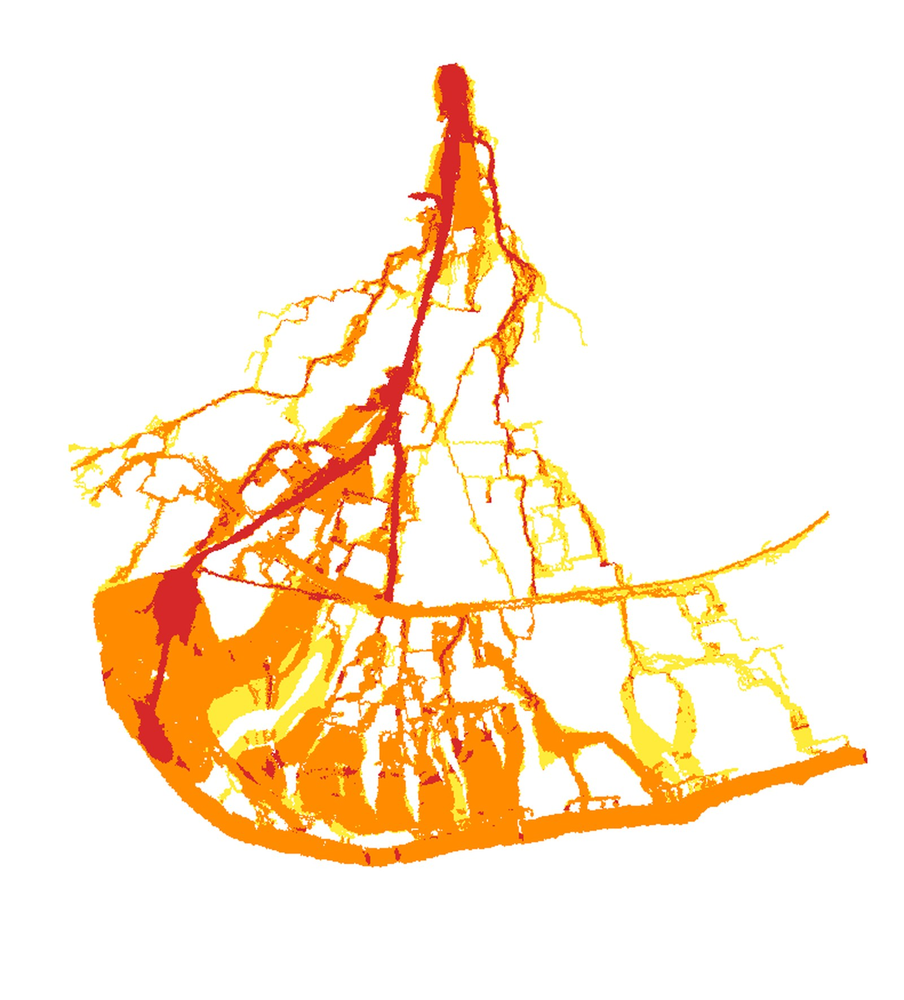
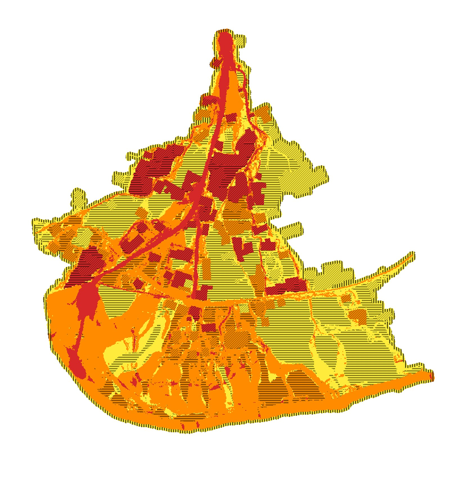
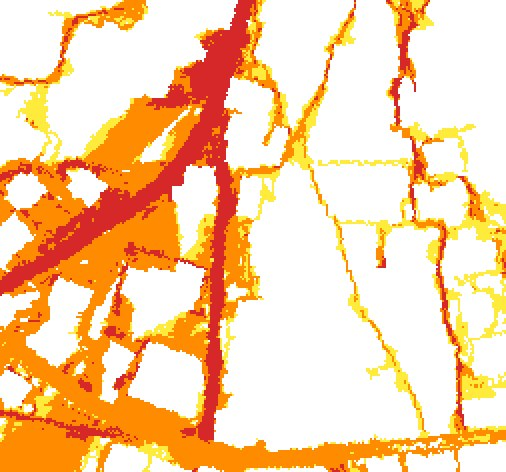
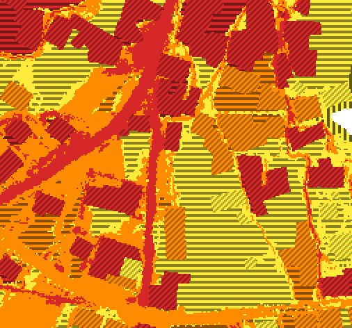
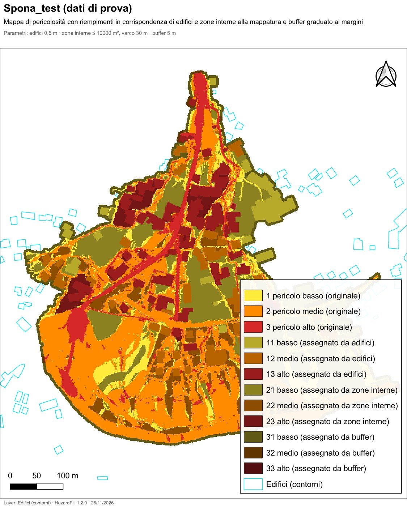

# Esempio passo-passo: Spona_test

> **I dati di [`examples/Spona_test`](../examples/Spona_test) sono dati di prova**: non sono mappature di pericolosità ufficiali né valutazioni reali. Sono un caso test **derivato da idrogrammi non «calati» nel contesto locale** e servono **solo a provare HazardFill (HF)**: non vanno usati per alcuna valutazione o decisione.

La cartella contiene un raster (`Mappa_Pericolo_Spona.tif`, 1 m, EPSG:32632, classi 0-3) e gli edifici (`Edifici/Edifici.shp`, 186 edifici).
**Un edificio è stato volutamente tolto** dallo shapefile ma è presente nel modello del terreno usato: con la sorgente **«forniti + OpenStreetMap»** HF lo recupera da OpenStreetMap, così si prova anche l'integrazione con OSM (il primo scaricamento può richiedere qualche decina di secondi).

## Edifici pronti da scaricare

* shapefile compresso: [`Edifici_Spona_test.zip`](https://github.com/HydrogeomorphologyTools/HazardFill/raw/main/examples/Spona_test/Edifici_Spona_test.zip)
* GeoPackage: [`Edifici_Spona_test.gpkg`](https://github.com/HydrogeomorphologyTools/HazardFill/raw/main/examples/Spona_test/Edifici_Spona_test.gpkg)
* il raster: [`Mappa_Pericolo_Spona.tif`](https://github.com/HydrogeomorphologyTools/HazardFill/raw/main/examples/Spona_test/Mappa_Pericolo_Spona.tif)

Nel plugin: aggiungi lo ZIP o il GeoPackage a QGIS (*Layer → Aggiungi layer vettoriale*, anche direttamente lo `.zip`) e indicalo come «Edifici», con sorgente **«forniti + OpenStreetMap»** (o «solo edifici forniti»).
Nella pagina web (locale o online): sezione «Carica i tuoi dati» → GeoTIFF e, come edifici, lo `.zip`; oppure il pulsante «Carica l'esempio».

## Con la pagina web

1. Avvia il server (`cd web && python server.py`) e apri http://localhost:8765: compare l'area **Spona_test**.

   

2. Lascia attivi i **valori di partenza** (edifici 0 m, riempimento per maggioranza) e attiva **Chiusura zone interne** e **Buffer graduato**.
   Per ripetere l'esempio qui sotto imposta: edifici **0,5 m** con sorgente **forniti + OpenStreetMap**, zone interne **10 000 m²**, varco **30 m**, buffer **5 m**
   (oppure apri direttamente `http://localhost:8765/?bld=1&bm=0.5&osm=1&holes=1&area=10000&gap=30&buf=1&bufm=5&hmode=major`).

   

3. Leggi le **statistiche**: con questi parametri i pixel modificati sono **43 427** dagli edifici (≈ 43 427 m²; 108 edifici su 213), **77 505** dalle zone interne (≈ 77 505 m²) e **17 182** dal buffer (≈ 17 182 m²). OpenStreetMap aggiunge 27 edifici mancanti nello shapefile, compreso quello tolto di proposito.
4. Confronta con l'originale (*sovrapponi originale*) e verifica sulla topografia che le modifiche abbiano senso.
5. **Esporta**:
   * *Esporta mappa (immagine)* → PNG con legenda, nord e scala;
   * *Esporta mappatura* → raster con codici (+ stile QGIS), raster solo classi, GeoPackage.

### Dettaglio

Si vede il criterio **edifici** (gli edifici assumono il valore dei pixel che li toccano), il **buffer** ai margini e le **zone interne** chiuse. Il retino distingue il criterio (edifici oblique, zone interne orizzontali, buffer verticali) e il colore la classe, come in legenda.

## Con il plugin QGIS

1. Aggiungi a QGIS `Mappa_Pericolo_Spona.tif` e `Edifici/Edifici.shp`, oppure usa *Raster → HazardFill → Apri cartella di dati…* sulla cartella `examples/Spona_test`.
2. *Raster → HazardFill → Elabora mappa di pericolosità…* e imposta gli stessi parametri (tolleranza 0,5 m, sorgente «forniti + OpenStreetMap», area 10 000 m², varco 30 m, riempimento «maggioranza», buffer 5 m).
   Indica il file di uscita (raster con codici) e, se vuoi, il vettoriale GeoPackage.
3. I risultati si aprono già con lo stile; il GeoPackage aggiunge i suoi livelli al progetto.
4. *Raster → HazardFill → Aggiungi basi cartografiche…* e poi *Esporta mappa con legenda, nord e scala (PNG)…* per ottenere l'immagine.

*(Nell'immagine del plugin non c'è la base cartografica, perché nel test non erano caricate basi.)*

## Cosa osservare

* I pixel con codice **≥ 11** sono quelli assegnati dallo strumento: sono il punto da discutere e da verificare.
* Se una zona chiusa corrisponde a un rilievo non raggiunto dal flusso, riduci l'area massima, lascia il varco a 0 o disattiva il criterio.
* Per un'impostazione prudente scegli il riempimento **massimo del contorno**.
