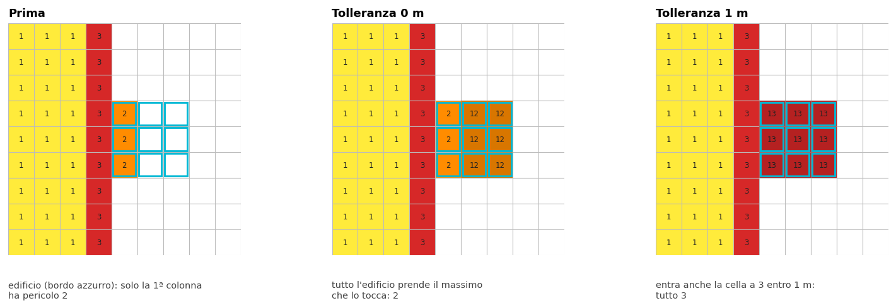
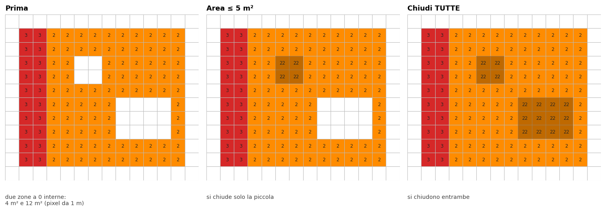
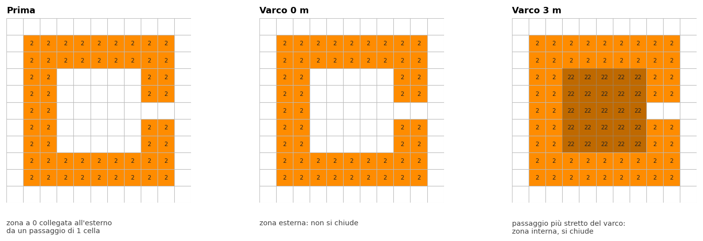
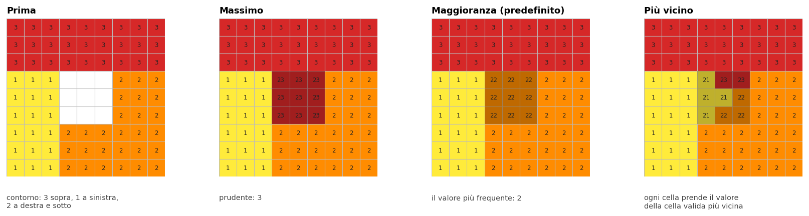
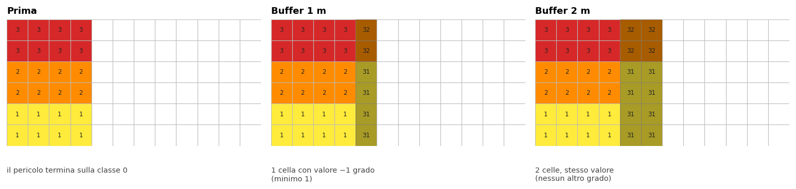
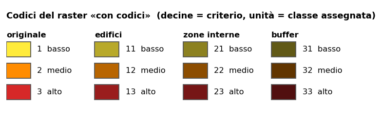

# Metodo

Il calcolo vive in un unico modulo, [`plugin/hazardfill/core.py`](../plugin/hazardfill/core.py), che usa solo **numpy** e **scipy**: lo importano sia il plugin QGIS sia la pagina web, e per questo i risultati coincidono pixel per pixel.

## Prima di tutto: la mappa in ingresso

Il raster è letto come intero 0-3: **NoData, NaN e valori negativi diventano 0**, i valori non interi sono arrotondati, i valori maggiori di 3 sono portati a 3.
Se la tua mappa usa altri codici, riclassificala prima (in QGIS: *Raster → Calcolatore raster*).

> **Cautela.** Poiché il NoData è assimilato a 0, lo strumento non distingue le aree *non raggiunte dal processo* da quelle *escluse dal calcolo*: le zone escluse
> dal calcolo possono risultare «interne» e venire riempite. Verifica sempre il risultato con la topografia.

## Criterio 0 — Edifici

Ogni edificio assume il valore **massimo** presente (a) nei pixel dell'impronta, (b) a contatto con il perimetro, (c) entro la **tolleranza** dal bordo.
Il valore viene assegnato ai pixel dell'impronta; un valore già presente **non viene mai abbassato**; se non ci sono valori utili **non si assegna nessuna classe**.

* L'impronta è rasterizzata includendo tutti i pixel toccati dal poligono.
* La tolleranza (m) è convertita in pixel con la risoluzione del raster (arrotondando) e misurata come distanza euclidea dal bordo.

## Criterio 1 — Chiusura delle zone interne

### Quali zone sono «interne»

Una zona a 0 è **interna** se non è collegata al margine del raster; con un **varco sigillabile** *g* > 0 lo è anche una zona collegata all'esterno solo da passaggi più stretti di *g*.
Per decidere, per una scala *r* = *g* / (2 × risoluzione):

1. si calcola per ogni pixel a 0 la distanza dal valore valido più vicino;
2. i pixel con distanza > *r* formano i «nuclei» larghi delle zone a 0;
3. i nuclei che toccano il bordo del raster (e i pixel a 0 sul bordo) sono **esterno**;
4. ogni altro pixel a 0 è assegnato al nucleo raggiungibile camminando solo sugli 0, con un'espansione simultanea dai nuclei;
5. i pixel non assegnati all'esterno sono **interni**.

Con *g* = 0 si usa direttamente l'etichettatura delle zone a 0 non connesse al bordo. Con *g* > 0 si fa l'unione dei risultati su tutte le scale (0, 5, 10, 15, 30, 45, 60, 90, 120, 150 pixel, più *r*) fino a *r*:
così sono prese sia la tasca stretta con apertura piccola, sia la baia larga con apertura grande.

### Quali zone si riempiono

Quelle con **area ≤ A** (m², convertiti in pixel) oppure **tutte** («chiudi TUTTE»), purché abbiano almeno un pixel valido adiacente.
Il **valore** assegnato è:

| modo | valore |
|---|---|
| **maggioranza** del contorno (predefinito) | il valore più frequente fra i pixel validi adiacenti alla zona |
| **massimo** del contorno | il valore più alto fra quelli adiacenti (scelta prudente) |
| **più vicino** | ogni pixel prende il valore del pixel valido più vicino (può mescolare più classi) |

## Criterio 2 — Buffer graduato sul margine

I pixel a 0 entro la distanza (m → pixel, minimo 1) dal pixel valido più vicino ricevono il valore di quest'ultimo **meno un grado, con minimo 1**.
I pixel già validi non sono mai modificati. Non è un gradiente: tutta la fascia prende lo stesso valore.

## Ordine dei passi e codici

I passi si applicano in quest'ordine: edifici → zone interne → buffer. Ogni pixel modificato porta il codice del **primo** passo che lo ha cambiato:
`codice = classe assegnata + 10 × passo` (1 edifici, 2 zone interne, 3 buffer). I pixel non modificati conservano il loro valore 0-3.

## Edifici da OpenStreetMap

La sorgente degli edifici può essere: **solo forniti**, **forniti + integra da OSM**, **solo OSM**.
Gli edifici sono scaricati dal servizio Overpass per l'estensione del raster (riquadri di 0,05°, con ritentativi su più server e cache su disco).
Con *integra*, un edificio OSM è aggiunto solo se **meno del 20%** dei suoi pixel cade su edifici già presenti. Delle relazioni multipoligono si usano gli anelli esterni chiusi.

## Complessità e risorse

Il calcolo lavora in memoria su tutto il raster. Ordini di grandezza su un computer portatile: raster di circa 6,7 milioni di pixel (2778 × 2430, 0,5 m) elaborato in ~7 secondi
(tre criteri, varco 30 m), vettoriale in ~12 secondi. La chiusura delle zone interne con varco grande è il passo più pesante.

## Limiti e buone pratiche

* Questi criteri sono **convenzioni cartografiche** da motivare e verificare caso per caso con la topografia, l'assetto geomorfologico e le condizioni di propagazione del processo.
* Non eliminare una discontinuità solo perché piccola o poco regolare: può essere reale (rilievi non raggiunti dal flusso).
* Il buffer estende la perimetrazione oltre il risultato modellistico; valori elevati vanno usati con cautela.
* Conserva sempre il raster con i codici: permette di distinguere in ogni momento dato simulato e dato assegnato.
* I parametri predefiniti sono **esempi di partenza**; la scelta finale spetta al decisore.
